<div align="center">

# 💧 Pichonkun and the Clean Air Adventure

**A 10-level pixel-art platformer about clean air, air conditioning and ecology. It runs in any web browser.**

[](https://iiogurt.github.io/Pichonkun-platformer/)

[](https://github.com/iiogurt/Pichonkun-platformer/actions/workflows/ci.yml)
[](https://github.com/iiogurt/Pichonkun-platformer/actions/workflows/pages.yml)
[](https://github.com/iiogurt/Pichonkun-platformer/releases/latest)
[](LICENSE)


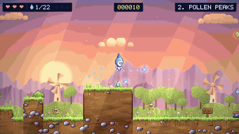

</div>

## The story

Breezeville's air was always fresh thanks to the **Great Air Conditioner** on the town hall.
Then **Smogmaw**, a greedy cloud of pollution, crawled out of the old factory and clogged every filter
with dust, pollen and germs.

**Pichonkun**, a tiny droplet of condensation born in the AC's cooling coil, sets out to wash the
air clean. His journey goes through meadows and smoggy streets, into the air conditioner itself
(intake ducts, filters, frozen coils, the drain and the compressor) and finally up to Smogmaw's sky.

## Features

- 🎮 **10 levels** with rising difficulty, each with its own look, music and mechanics
- 🎨 **Detailed pixel art**, all generated by code: painted terrain, animated parallax backdrops, dynamic lighting, weather and particles
- 💦 **Action**: shoot water splashes (also diagonally up), squish enemies, and unlock the **Vapor Jump**
- 🦠 **8 enemy types**: pollen, pollen-spitting flowers, bacteria, dust bunnies, spiky viruses, smog clouds, mold turrets, germ flies
- 👑 **3 boss fights**: Dust Baron, Mold Queen and Smogmaw
- 🧩 **14 easy riddles** about water, filters, fans and energy saving, plus **3 lever puzzles**. Wrong answers get a hint.
- 💬 **Story and characters**: Leafa, Prof. Mesh, Frosty, Buzzby and Granny Cloud, with an 🌱 eco tip after every level
- 🎵 **Chiptune music and sound effects**, made live with WebAudio
- 🏆 **Score, ranks and a leaderboard**: combos for quick clean-ups, bonuses for speed and for taking no damage, an S–D rank per level and a local top-10 table to climb
- 💎 **30 hidden air crystals** (three per level), some tucked behind **secret walls**
- 🎖️ **18 achievements** and **5 reward skins** for Pichonkun (mint, rose, violet, gold, ember)
- 🔥 **Hard mode**, unlocked by finishing the game: 2 hearts, tougher and faster enemies, score ×1.5
- 💾 **Auto-save** at checkpoints and milestones, plus **Continue** and **Level Select**
- 📱 Works with keyboard or touch controls

## Screenshots

| | |
|---|---|
| 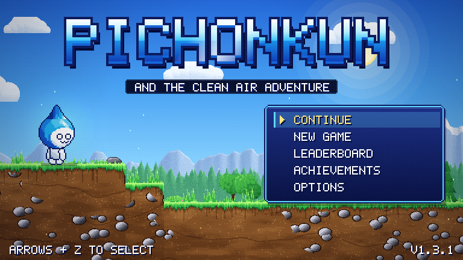 | 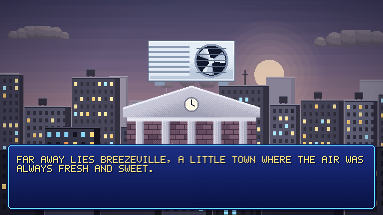 |
| **Title screen** | **The story begins** |
| 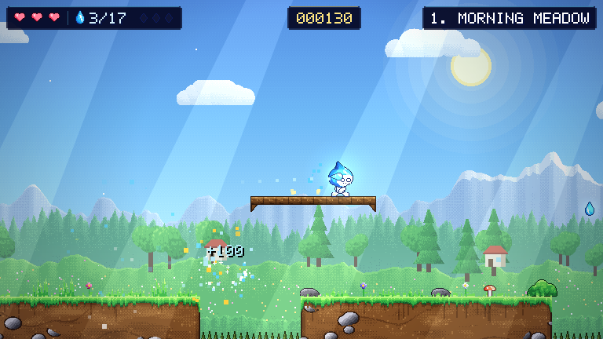 | 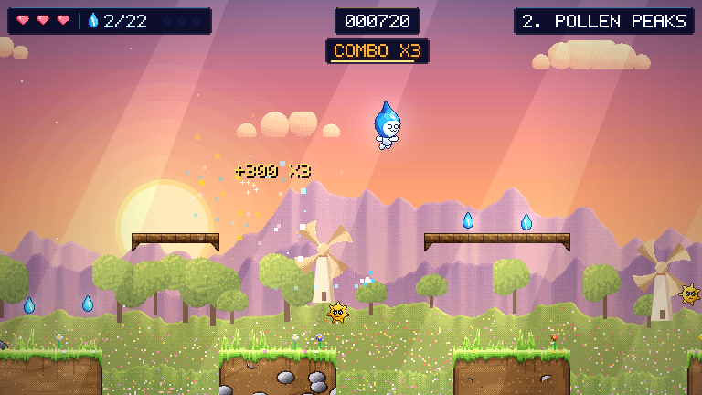 |
| **1 · Morning Meadow** | **2 · Pollen Peaks** |
| 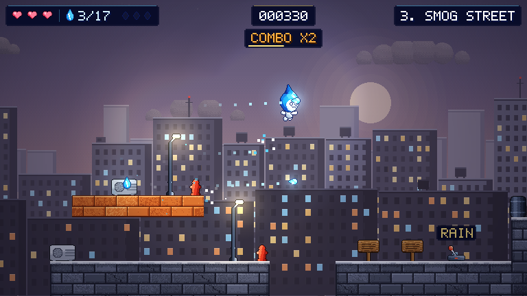 | 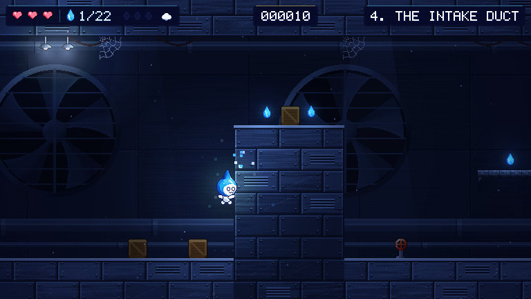 |
| **3 · Smog Street** | **4 · The Intake Duct** |
| 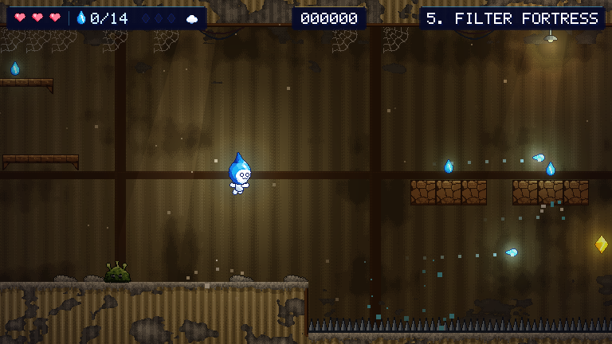 | 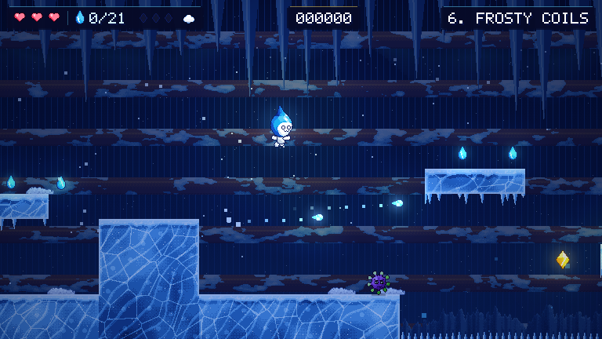 |
| **5 · Filter Fortress** | **6 · Frosty Coils** |
| 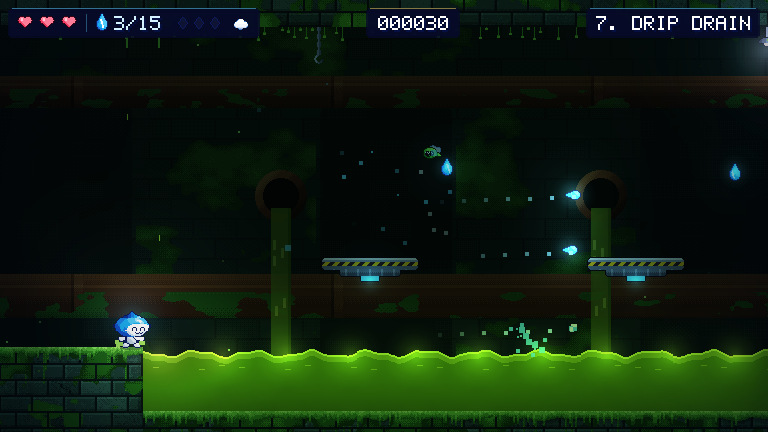 | 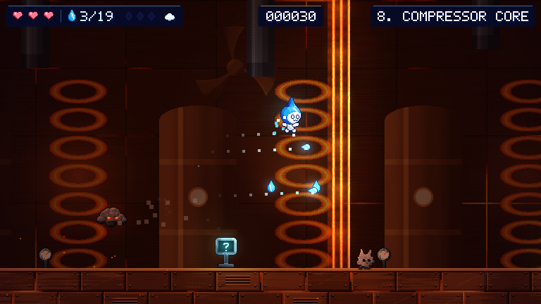 |
| **7 · Drip Drain** | **8 · Compressor Core** |
| 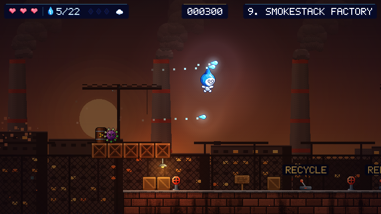 | 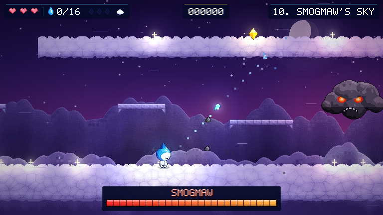 |
| **9 · Smokestack Factory** | **10 · Smogmaw's Sky (final boss)** |
| 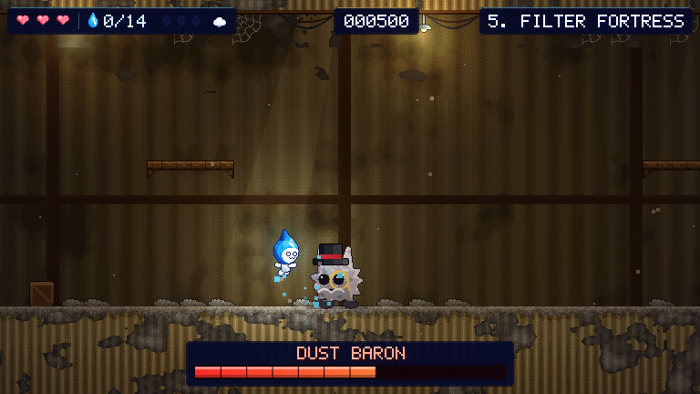 | 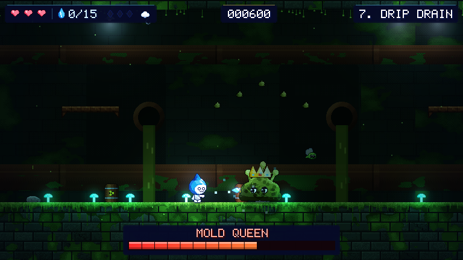 |
| **Boss: Dust Baron** | **Boss: Mold Queen** |
| 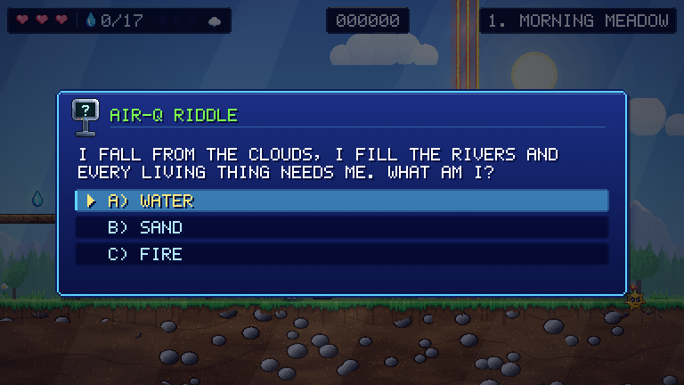 | 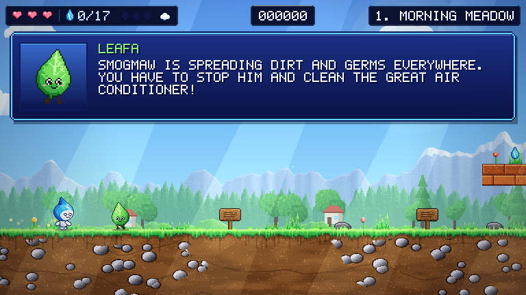 |
| **Air-Q riddle gates** | **Story and dialogue** |
| 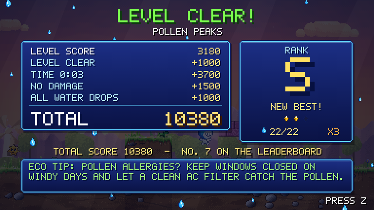 | 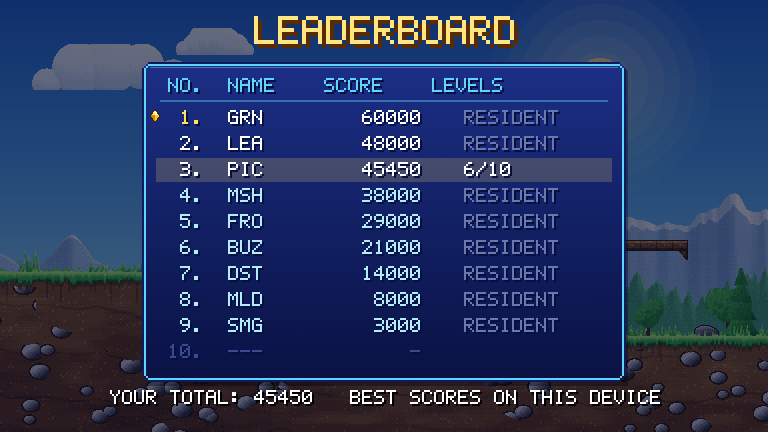 |
| **Score tally and rank** | **Leaderboard** |
| 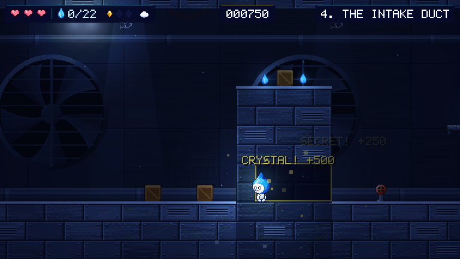 | 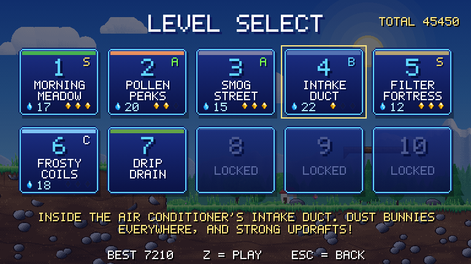 |
| **A secret room with an air crystal** | **Level select with ranks and crystals** |
| 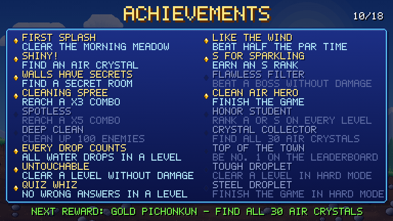 | 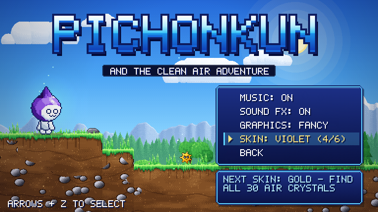 |
| **Achievements** | **Reward skins (Options)** |
| 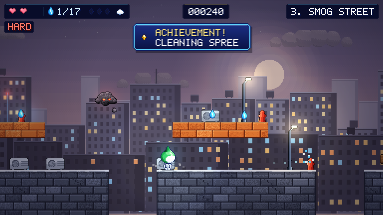 | 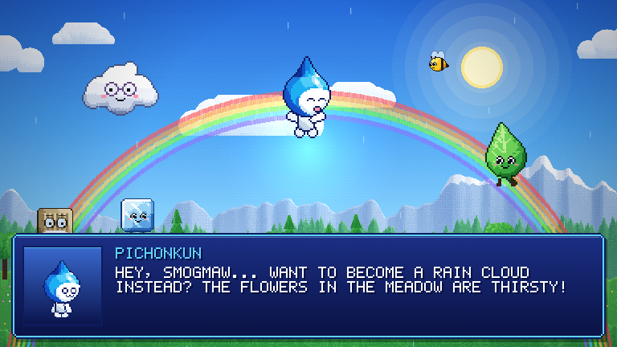 |
| **Hard mode, mint skin, an achievement** | **The ending** |

## How to play

**Online:** https://iiogurt.github.io/Pichonkun-platformer/

**Offline:** download the zip from the [latest release](https://github.com/iiogurt/Pichonkun-platformer/releases/latest),
unzip it and open `index.html`.

### Controls

| Action | Keyboard |
|---|---|
| Move | ← → / A D |
| Jump (hold = higher, press again in air = Vapor Jump) | Z / Space / K |
| Shoot water splash | X / J |
| Aim upward | hold ↑ / W while shooting |
| Talk · answer riddle · pull lever | ↑ / W / E (when the arrow prompt shows) |
| Drop through a thin platform | ↓ + Jump |
| Pause | Esc / P |
| Music on/off | M |

If the game runs slowly, set **Graphics** to **FAST** under **Options** on the title screen, or in the pause menu. The game also does this by itself on slow devices.

On phones and tablets, on-screen buttons appear automatically.

### Levels

| # | Level | New in this level |
|---|---|---|
| 1 | Morning Meadow | Tutorial, pollen, the first riddle gate |
| 2 | Pollen Peaks | Spring pads, pollen-spitting flowers |
| 3 | Smog Street | Rooftop gaps, smog clouds, water-cycle lever puzzle |
| 4 | The Intake Duct | **Vapor Jump**, updrafts, crumbling blocks, moving lifts |
| 5 | Filter Fortress | Mold turrets · 👑 **Dust Baron** |
| 6 | Frosty Coils | Slippery ice, spiky flu viruses |
| 7 | Drip Drain | Toxic sludge, vertical lifts, germ flies · 👑 **Mold Queen** |
| 8 | Compressor Core | Conveyor belts, hot vents, "eco AC setup" puzzle |
| 9 | Smokestack Factory | Everything at once, the 3 R's puzzle |
| 10 | Smogmaw's Sky | Cloud platforms · 👑 **Smogmaw** |

### Scoring

| What | Points |
| --- | --- |
| Water drop | 10 |
| Cleaning an enemy | 100 per hit point, +50 for a stomp |
| **Combo**: clean another enemy within 2.5 seconds | ×2, ×3 … up to ×5 |
| Riddle or lever puzzle | 500 on the first try, 250 on the second, 100 after that |
| Boss | 100 per hit, 3000 for the win |
| 💎 Air crystal (3 per level) | 500 each |
| Finding a secret room | 250 |
| Picking up a heart at full health | 200 |
| **End of level** | 1000 for the clear, 20 per second under the par time, 1500 for no damage (or 500 for no deaths), 1000 for all drops, 1500 for all three crystals |

Each level gives a rank from **D** to **S**. Your best score per level is kept, so replaying a level from
**Level Select** can only raise your total. The total goes on the **Leaderboard** under your three initials,
next to the residents of Breezeville.

Secret walls look like ordinary ground but Pichonkun can walk through them. Watch for a faint twinkle.

The leaderboard is local: it lists the best scores made in this browser on this device.

### Achievements and rewards

There are 18 achievements, listed under **Achievements** on the title screen. They range from clearing the
first level to finishing the game in hard mode. Achievements, crystals found and rewards are kept when you
start a **New Game**.

Rewards are new colours for Pichonkun, chosen under **Options → Skin**:

| Skin | How to unlock |
| --- | --- |
| Mint | Find 10 air crystals |
| Rose | Earn 8 achievements |
| Violet | Finish the game |
| Gold | Find all 30 air crystals |
| Ember | Finish the game in hard mode |

### Hard mode

Finish the game once, then choose **New Game → Hard**. Pichonkun has 2 hearts instead of 3, enemies take
one more hit, bosses have 50% more health, and both move and shoot faster. Every point is worth ×1.5, so
hard-mode runs climb the leaderboard faster.

### Saving

The game saves to your browser's `localStorage` at these points:

- reaching a ⛳ checkpoint
- solving a riddle or puzzle
- getting the Vapor Jump
- defeating a boss
- finding an air crystal
- clearing a level

A **SAVED** badge appears in the corner each time.

## Development

The game is plain HTML5 canvas and JavaScript with **no runtime dependencies** and no build step.
Node is only needed for the dev tools.

```bash
npm install
npm run serve        # play at http://localhost:8000
npm run check        # lint + level validation + headless smoke test
npm run screenshots  # regenerate docs/screenshots
npm run gif          # re-record docs/gameplay.gif (needs ffmpeg)
```

```
index.html          page shell and touch controls
style.css
js/font.js          5x7 bitmap font
js/gfx.js           procedural pixel-art toolkit (noise, shapes, colour ramps, dithering)
js/sprites.js       characters, enemies, bosses, NPCs and objects
js/terrain.js       painted terrain per theme, decorative props
js/backdrops.js     animated parallax backdrops
js/audio.js         WebAudio chiptune synth, music tracks, sound effects
js/levels.js        level maps (ASCII), story, dialogue, riddles
js/awards.js        achievements, reward skins, hard-mode settings
js/world.js         physics, player, enemies, bosses
js/game.js          game states, saving, input
js/render.js        drawing: lighting, bloom, particles, HUD, menus
js/main.js          boot and main loop
tools/              level validator, smoke test, screenshot generator
style_cards/        character style reference
```

Every push and pull request runs [CI](.github/workflows/ci.yml): ESLint, level-data validation,
and a headless Chrome test. That test plays all 10 levels and checks riddles, puzzles, bosses,
saving and the ending. Pushes to `main` deploy to GitHub Pages, and `v*` tags publish a
[release](https://github.com/iiogurt/Pichonkun-platformer/releases).

## Contributing

Ideas for levels, riddles and enemies are very welcome. See [CONTRIBUTING.md](CONTRIBUTING.md),
the [Roadmap](ROADMAP.md) and the [Changelog](CHANGELOG.md).

## License

[MIT](LICENSE) © iiogurt
